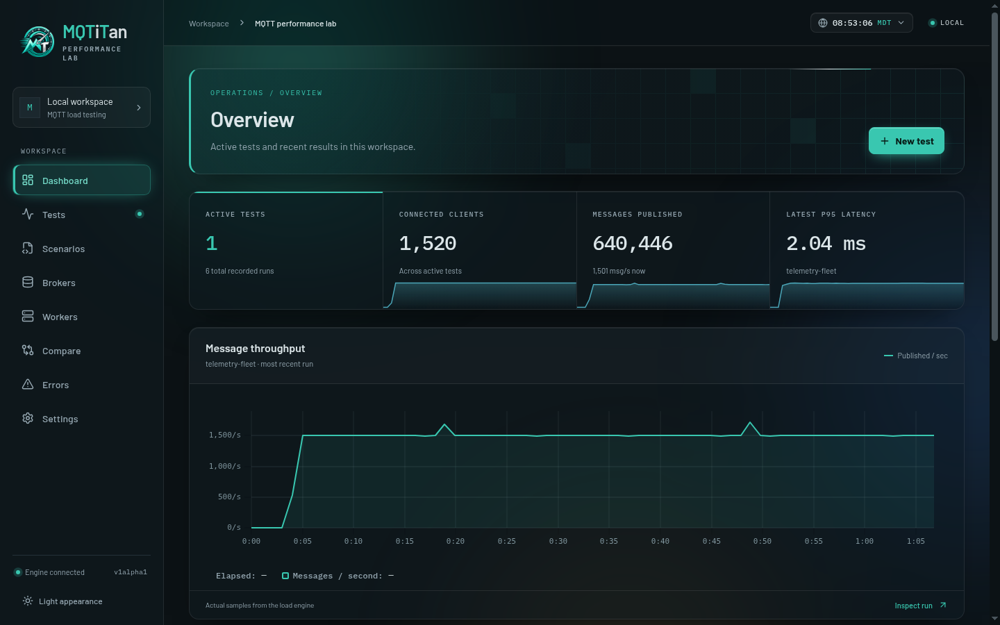
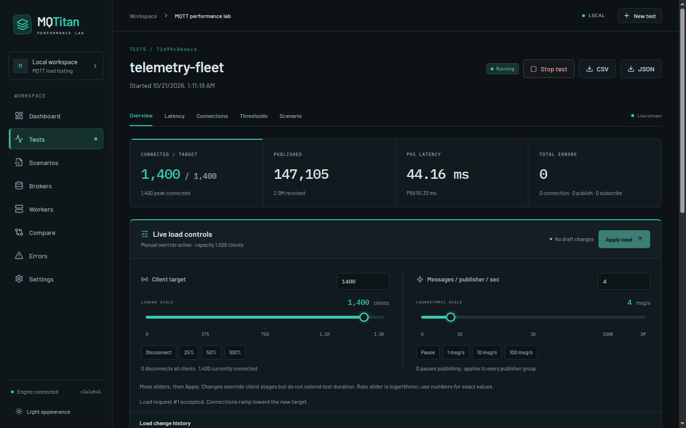
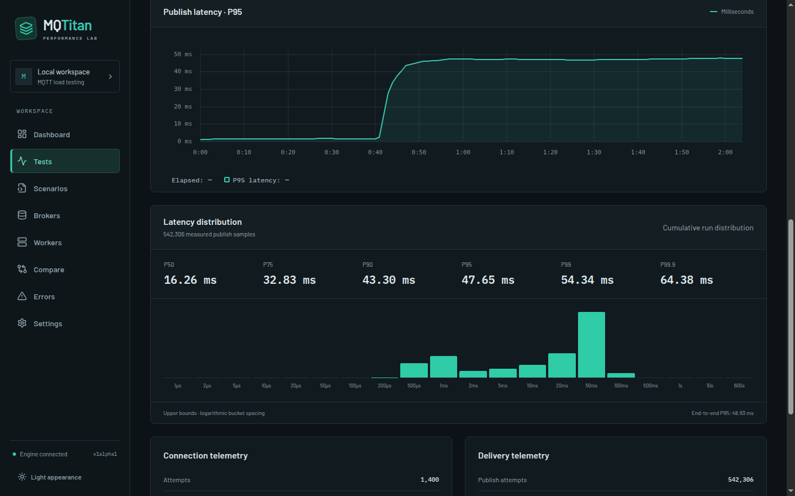
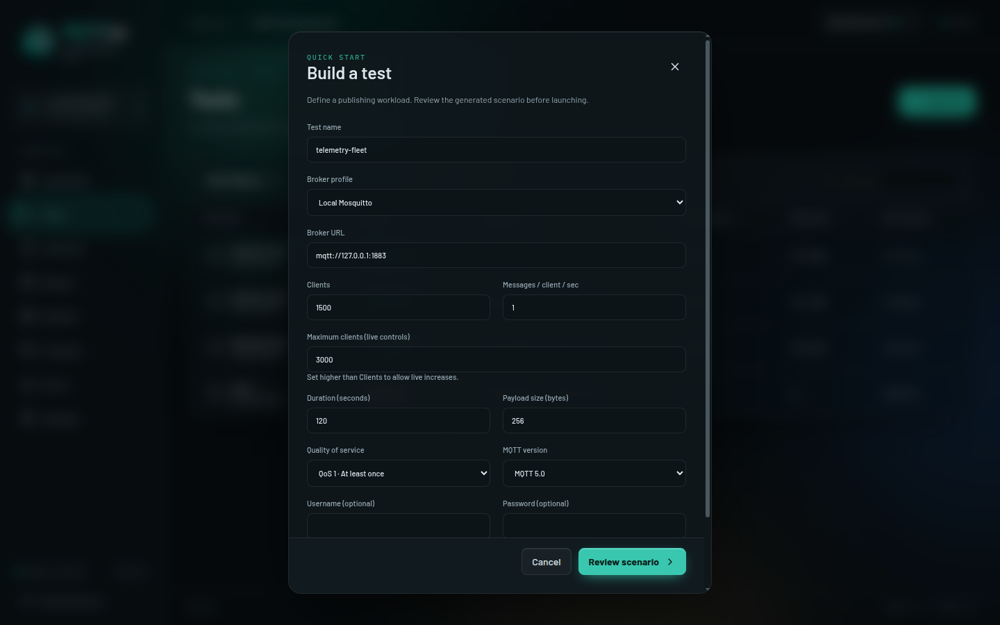
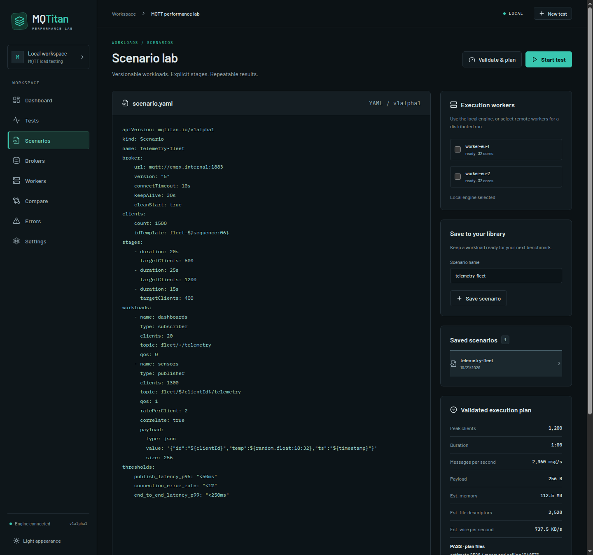
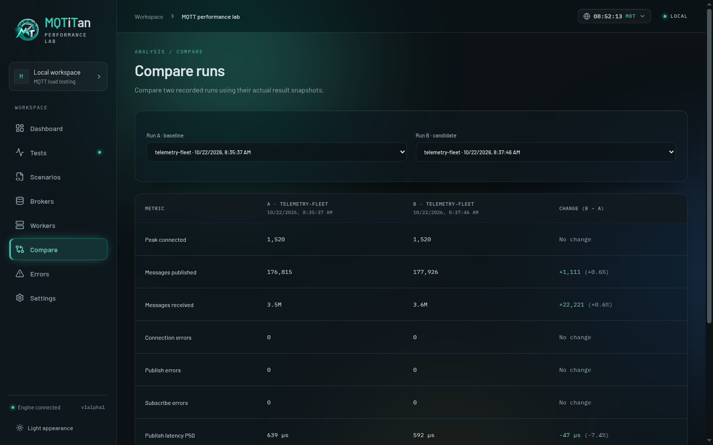
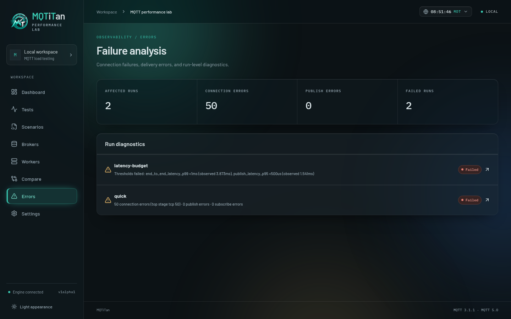
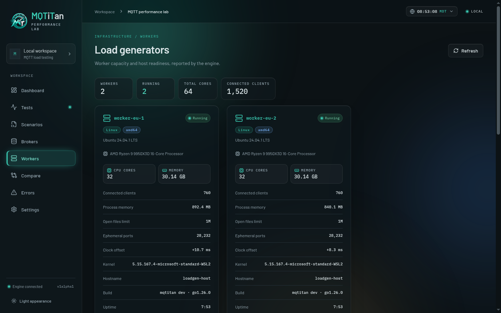
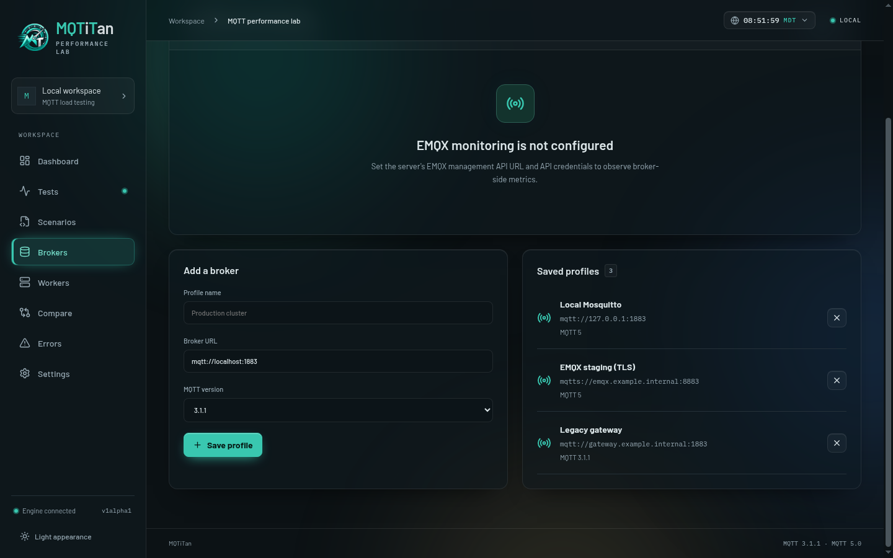

<p align="center">
  
</p>

# MQTTitan



MQTTitan is an open-source MQTT load-testing platform for EMQX and standards-compatible brokers, with a Go CLI/controller and a React operations dashboard. This is a working engineering preview, not a certified production release.

## Quick start

Prerequisites: Go 1.26, Node.js 22, npm, Make, and a running MQTT broker. The source build embeds the dashboard in one binary.

```bash
git clone https://github.com/hawxxx/mqtitan.git
cd mqtitan
make build
./bin/mqtitan quick --broker mqtt://localhost:1883 --clients 1000 --rate 1 --duration 30s
```

Open http://127.0.0.1:8080 while the test runs. The local command shuts down its dashboard server when the test finishes; results remain in `mqtitan.db`.

For a dashboard that stays available, start the controller in one terminal:

```bash
./bin/mqtitan serve --listen 127.0.0.1:8080 --data ./mqtitan.db
```

Run tests against that controller from another terminal, or create them in the browser:

```bash
./bin/mqtitan quick --controller http://127.0.0.1:8080 \
  --broker mqtt://localhost:1883 --clients 1000 --rate 1 --duration 30s
```

Inspect a reusable scenario before running it:

```bash
./bin/mqtitan validate examples/10k.yaml
./bin/mqtitan plan examples/10k.yaml
./bin/mqtitan doctor
# Generates real broker traffic; review the plan first.
./bin/mqtitan run examples/10k.yaml --controller http://127.0.0.1:8080
```

`quick --save scenario.yaml` saves a reusable configuration. Do not start two controllers on the same port or open the same database from independent processes.

For containers, follow the [Docker and Compose walkthrough](docs/docker.md). For a cluster, use the [Kubernetes and Helm walkthrough](docs/kubernetes.md). Both explain setup, authentication, running tests, distributed workers, and data retention. [Operations](docs/operations.md) covers advanced deployment, CI thresholds, and host tuning.

The test wizard supports [certificate uploads](docs/certificates.md): custom CA trust, client certificates/private keys for mTLS, reusable encrypted profiles, and SNI overrides for secure MQTT or WebSocket endpoints.

Use [live load controls](docs/live-controls.md) to adjust client targets and message rates during a test. Set spare client capacity in the wizard, then use sliders and **Apply load** on the live test screen. Local and distributed execution share the same controls; changes are recorded in results.

Open a finished test and click **Run again** to launch a fresh run from its original scenario while preserving the previous results. Credentials are reused server-side, and recorded workers are retained. See [rerunning tests](docs/reruns.md) for legacy runs and worker availability.

See [architecture](docs/architecture/overview.md), [diagrams](docs/architecture/diagrams.md), [scenario specification](docs/scenario-spec.md), and [roadmap](docs/roadmap.md).

## Feature tour

The screenshots below come from real runs against a local Mosquitto broker: 1,500 MQTT 5 clients publishing correlated JSON telemetry at QoS 1, with 20 wildcard subscribers measuring end-to-end latency.

### Live test control

Every running test streams its metrics over server-sent events. Live load controls change the client target and per-publisher message rate mid-run; each change is persisted before it is applied and listed in the load change history.



### Latency analysis

Publish latency is recorded in HDR histograms and shown as a P95 timeline, exact percentiles from P50 to P99.9, and a log-scale distribution. Correlated runs also report end-to-end latency from publisher to subscriber.



### Test wizard

Build a publishing workload without writing YAML: clients, spare capacity for live increases, rate, duration, payload size, QoS, MQTT version, credentials, and TLS certificate profiles for `mqtts://` and `wss://` brokers. The wizard shows the target throughput and approximate wire rate, then opens the generated scenario for review.



### Scenario lab

Edit versionable YAML scenarios with staged client populations, mixed workloads, payload templates, and thresholds. **Validate & plan** checks the scenario and estimates peak clients, message rate, memory, file descriptors and bandwidth against this host's measured limits. Save scenarios to the library or start them locally or on distributed workers.



### Compare runs

Put a baseline and a candidate side by side. Changes are colored by direction: lower latency and fewer errors read as improvements, as do more connections and messages.



### Failure analysis

Runs with connection, publish or subscribe errors, failed thresholds, or interrupted execution are collected in one place with their diagnostic message.



### Distributed workers

Workers register with the controller, receive a contiguous slice of the client population, and report merged metrics and HDR distributions. The workers page also shows the host readiness checks from `mqtitan doctor`.



### Broker profiles

Save broker connections in the browser and pick them in the wizard. When the controller is configured with EMQX management API credentials, the same page shows broker-side connections and message counters.



## Documentation

Start with the [documentation index](docs/README.md), [CLI reference](docs/cli.md), [REST API](docs/api.md), or [troubleshooting](docs/troubleshooting.md). Development and verification commands are in [Contributing](CONTRIBUTING.md).

## Status

Implemented: MQTT 3.1.1/5 over TCP/TLS/WebSocket, publisher/subscriber/mixed workloads, staged client populations, bounded reconnects, dynamic payloads, HDR latency metrics, end-to-end correlation, encrypted scenario storage, REST/SSE, live dashboards, comparisons, distributed partitions, optional EMQX telemetry, Prometheus, OpenTelemetry, Docker and Helm.

Production release gates remain: independently calibrated large-scale capacity, million-client testing, extended fault/soak coverage, and security review. Advanced requirements not yet implemented include credential datasets, global/Poisson/burst rate models, arbitrary MQTT 5 properties, native LDAP, PostgreSQL, automatic Kubernetes scaling, and external fault orchestration. Do not interpret a supplied large scenario as proven generator capacity. `plan` estimates are explicitly uncalibrated; use `doctor` and measure worker resource limits before scaling.

Back up the database **and its adjacent `.key` file** together. Losing the key makes encrypted records unreadable. Never commit either file. Local unauthenticated mode defaults to loopback; remote deployments must configure authentication and TLS at the ingress/reverse proxy.

## License

Apache-2.0; see [LICENSE](LICENSE) and [third-party notices](THIRD_PARTY_NOTICES.md).
