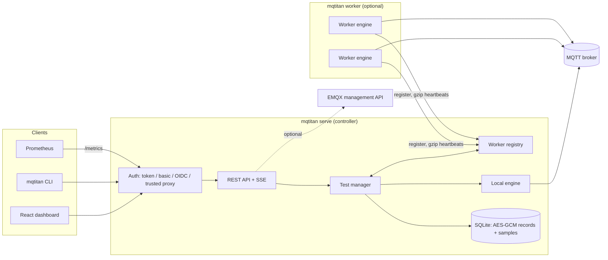
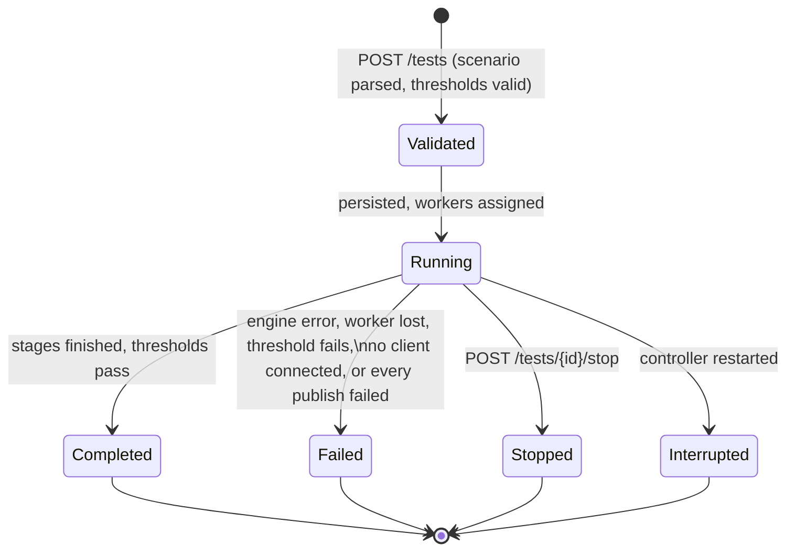
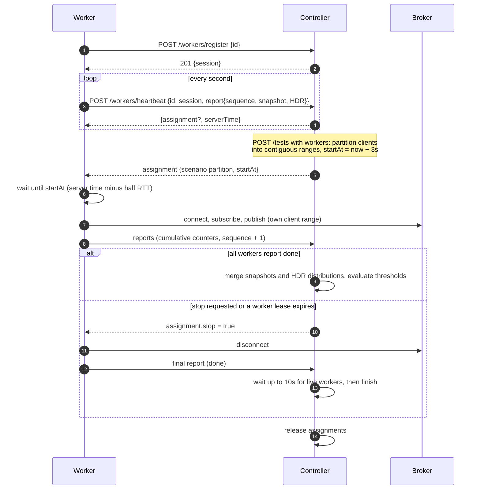
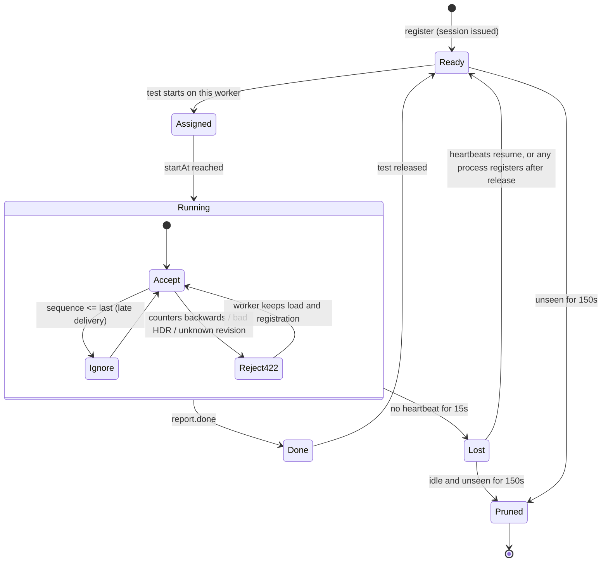
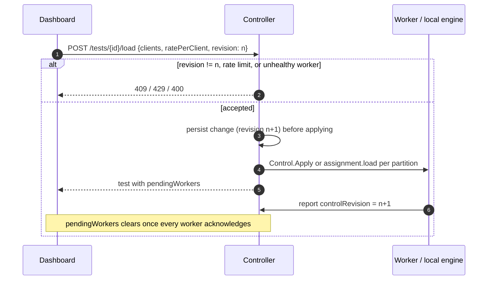
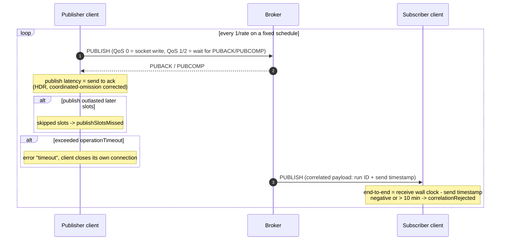
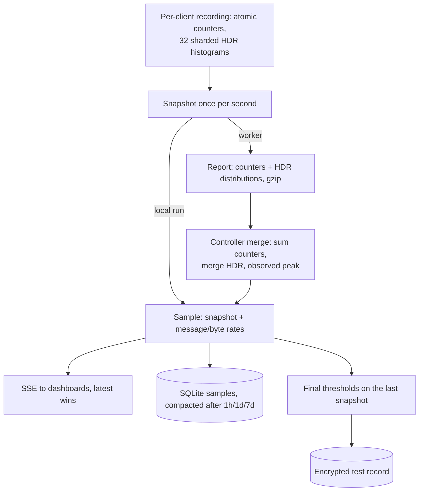
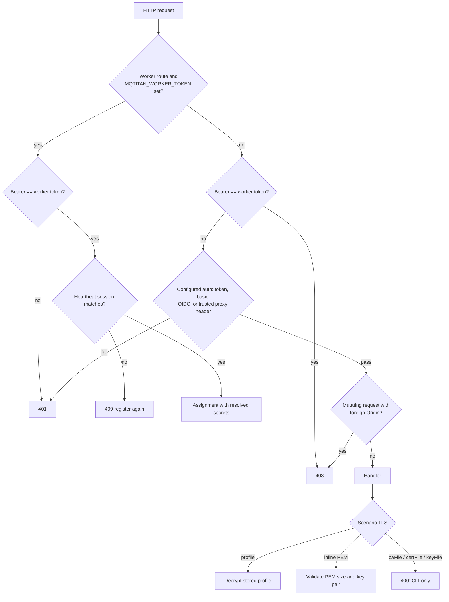

# Architecture diagrams

These diagrams describe implemented behavior. Where a capability is absent (automatic worker replacement, clock-offset correction), the diagrams show what happens instead. Prose details are in the [architecture overview](overview.md).

## Components

Only one test runs at a time. A test runs either on the local engine or on the selected workers.

## Test lifecycle

`Run again` creates a new test from the stored scenario; earlier results are never modified.

## Distributed run: registration to shutdown

Worker assignments contain resolved broker credentials. The worker routes accept only `MQTITAN_WORKER_TOKEN` when it is configured, and every heartbeat must carry the session issued at registration.

## Worker lease and report handling

A lost worker fails the run. Its last cumulative counters stay in the result, its live gauges are zeroed, and its ID is listed in `lostWorkers`. Partitions are not reassigned.

## Live load control

## Publishing and measurement

End-to-end latency across hosts is only as accurate as clock synchronization between them; the controller records each worker's clock offset but does not correct for it.

## Telemetry aggregation and persistence

## Authentication and certificate handling

